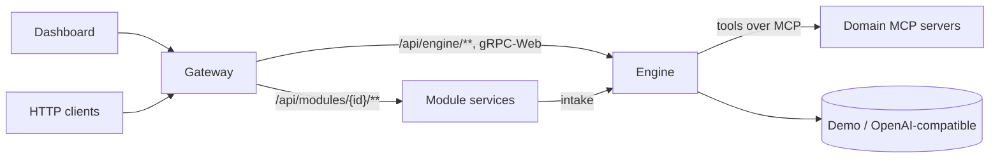

# Flowgent


**A configurable agentic system: define LLM workflows, plug in your own domain logic, and watch the engine work from a control dashboard.**

> ⚠️ **Beta.** Flowgent is in early development. It runs and the images below are published, but APIs, workflow formats, configuration keys and image contents can still change between releases. Not production-ready yet. The first published images are tagged `v0.1.0-alpha.1`.

---

## What it is

Flowgent is a base for running **LLM-driven agentic workflows**. You describe a workflow once, as a declarative document, and a reusable engine runs it — validating input, calling the model, routing through steps, pausing for human approval, and recording everything. Your business logic stays **outside** the engine, plugged in as a custom module the engine reaches over MCP. A generic dashboard shows, in real time, what the engine is doing.

The idea: stop rebuilding the plumbing. The engine, the gateway, the dashboard and the human-in-the-loop machinery are domain-agnostic and reusable. What changes from one use case to the next is *your* workflow definition and *your* domain tools.

## What problem it solves

If you want to build agentic/LLM workflows across different domains, you normally end up re-writing the same scaffolding every time: a run engine, state and event tracking, an approval flow, a monitoring UI, an ingress. Flowgent gives you that scaffolding once and lets you focus on the part that is actually yours.

Three things it is built around:

- **Configurable** — workflows are declarative documents (Microsoft Agent Framework + PowerFx), not code baked into the engine. You add or change a workflow without touching the engine, the gateway or the dashboard.
- **Extensible** — your domain logic is a **custom module** with its own tools, plugged in over MCP (Streamable HTTP). The engine stays domain-agnostic; the shipped `support` module is a worked example of how to write one, not part of the core.
- **Observable** — a **control dashboard** streams what the engine is doing: active runs, each step, pending approvals, the event log, the inbox and the agents at work.

## How to use it (container images)

The platform ships as four stock container images on GitHub Container Registry. This round covers running the images directly; a one-command `docker compose` example comes in the next round.

**Core platform** (domain-agnostic, reusable):

| Image | Role | Port |
|-------|------|------|
| `ghcr.io/gabrieletronchin/flowgent-engine` | runs the workflows, owns runs/events/inbox/human-input/telemetry | 8080 |
| `ghcr.io/gabrieletronchin/flowgent-gateway` | single ingress (YARP) for the dashboard and clients | 8080 |
| `ghcr.io/gabrieletronchin/flowgent-dashboard` | the control console (React) | 80 |

**Example domain module** (how to write your own — not part of the core platform):

| Image | Role | Port |
|-------|------|------|
| `ghcr.io/gabrieletronchin/flowgent-support-mcp` | the support demo's `locateComponent` domain tool over MCP | 8080 |

```bash
# pull the pre-release images
docker pull ghcr.io/gabrieletronchin/flowgent-engine:alpha
docker pull ghcr.io/gabrieletronchin/flowgent-gateway:alpha
docker pull ghcr.io/gabrieletronchin/flowgent-dashboard:alpha
docker pull ghcr.io/gabrieletronchin/flowgent-support-mcp:alpha
```

The engine runs in **Demo mode** by default — no API key, every workflow answers offline from the responses declared in its YAML — so you can try the whole thing without a model. See [`deploy/README.md`](deploy/README.md) for each image's environment variables, ports and a stand-alone `docker run` per image, and for the versioning scheme.

## What you see in the dashboard

The dashboard adapts to the selected workflow and streams the engine's state live:

- **Overview** — the current picture at a glance
- **Runs** — every run, its status and current step
- **Approvals** — runs paused for human approve/reject
- **Event log** — the per-run transition history
- **Inbox** — queued and in-flight intake
- **Agents** — the LLM agents and what they are working on

## Status & roadmap

Flowgent is **beta / early**. What works today: the engine runs declarative workflows end-to-end in Demo mode, domain tools are reached over MCP-over-HTTP, the four images build and publish to GHCR, and the dashboard streams run state. Known rough edges and next steps:

- A one-command `docker compose` example wiring all four images together (next round).
- Expect changes to workflow formats, config keys and APIs before 1.0.
- A couple of integration tests have documented timing flakiness, tracked separately.

---

## For contributors / architecture

The sections below describe how Flowgent is built — useful if you want to contribute or understand the agentic modelling. For day-to-day use, the sections above are enough.

### Topology



- **Engine** — validates and runs workflows; owns runs, events, the inbox, human input, LLM access (Demo or OpenAI-compatible) and telemetry. Contains no domain code.
- **Modules** — publish their workflow definitions and expose domain tools over MCP.
- **Gateway** — the single entry point for the dashboard and clients.
- **Dashboard** — adapts to the selected workflow (graph, form, approvals, runs, agents, events).

Details: [Architecture](docs/architecture.md).

### Running from source

Requirements: .NET 10 SDK, Node.js 20.19+.

```bash
git clone <repository-url> flowgent
cd flowgent
cd dashboard && npm install && cd ..

# Engine, enabled modules, gateway and dashboard (.NET Aspire)
dotnet run --project backend/src/AppHost/Flowgent.AppHost
```

| What | Where |
|------|-------|
| Monitoring dashboard | http://localhost:5173 |
| Gateway (API entry point) | http://localhost:5080 |
| Aspire dashboard (logs, traces, metrics) | http://localhost:15080 |

Services can also be started one by one; see [Orchestration](docs/orchestration.md). To use a real model instead of Demo mode, set `Flowgent:Llm`; see [Demo mode](docs/demo-mode.md).

### Build and test

```bash
dotnet build backend/Flowgent.slnx
dotnet test --solution backend/Flowgent.slnx

cd dashboard
npm run typecheck
npm run test -- --run
npm run build
```

Tests run in-process (`Flowgent.Testing.PlatformHarness`): no ports, no Aspire, Demo mode.

### Repository structure

```
backend/
├── Flowgent.slnx                   # single solution (backend and modules)
├── src/
│   ├── Engine/                     # Flowgent.Contracts, .Definitions, .Runtime, .Persistence
│   ├── Services/                   # Flowgent.Engine.Service, Flowgent.Gateway, Flowgent.Mcp.Support
│   ├── Sdk/                        # Flowgent.Module.Sdk, Flowgent.Testing
│   └── AppHost/                    # Flowgent.AppHost, Flowgent.ServiceDefaults
└── tests/                          # Engine, Gateway, Architecture, Integration tests, Fixtures/
modules/
├── _template/                      # module template
├── jokes/                          # tiny example module (single llm step, no tools)
└── support/                        # support example module (definition, service, tests, dummy-apps, docs)
deploy/                             # Dockerfiles + GHCR publish workflow
dashboard/                          # React control console
docs/                               # platform documentation (how it works)
```

### Modules in this repo

| Module | Folder | Description |
|--------|--------|-------------|
| Support | [`modules/support`](modules/support/README.md) | Example domain module: triages support emails and proposes code fixes after human approval. Its MCP tool ships as the `flowgent-support-mcp` image. |
| Jokes | [`modules/jokes`](modules/jokes/definition/module.yaml) | Tiny example: one `llm` step turns a topic into a one-liner. A good starting point to read. |
| Template | [`modules/_template`](modules/_template/README.md) | Minimal module to copy when creating a new one. |

### Documentation

| Document | Content |
|----------|---------|
| [Architecture](docs/architecture.md) | Services, contracts, module catalog, run model, persistence, dependency rules |
| [Workflow reference](docs/workflow-reference.md) | `module.yaml`, MAF declarative workflows, action kinds, samples, validation |
| [Expressions](docs/expressions.md) | PowerFx expressions and conditions in declarative workflows |
| [Module authoring](docs/module-authoring.md) | Creating a module from the template: SDK, tools, endpoints, registration, tests |
| [Gateway](docs/gateway.md) | Routes, configuration, correlation id, 503 handling |
| [Engine API](docs/engine-api.md) | `/api/engine` endpoints, gRPC stream, engine configuration |
| [Demo mode](docs/demo-mode.md) | LLM providers and demo responses |
| [Inbox](docs/inbox.md) | Asynchronous intake and processing |
| [Human input](docs/human-input.md) | Approve, reject and abort |
| [Dashboard](docs/dashboard.md) | Pages, graph, form, real-time updates |
| [Orchestration](docs/orchestration.md) | AppHost, standalone services, observability |
| [Debugging](docs/debugging.md) | `.http` files, troubleshooting, traces |

## License

This project is licensed under the MIT License. See [LICENSE](LICENSE) for details.
