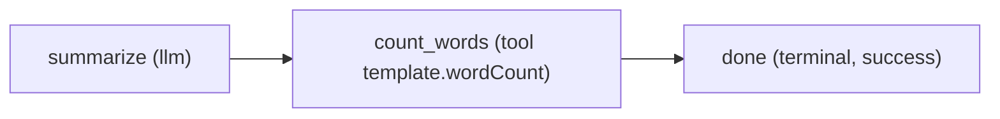

# Template module

A minimal, valid Flowgent module to copy when you start a new one. It has one workflow, `template-hello`:



- `summarize` asks the LLM for a short summary (structured output, `schemas/summary.schema.json`). In Demo mode the answer comes from `definition/demo/template-hello.yaml` instead, so no API key is needed. The file is optional and commented; copy it for your own agent steps.
- `count_words` calls the module's own tool `template.wordCount` (C# code in `service/WordCountTool.cs`).
- `done` ends the run with the summary and the word count.

## Layout

```
backend/template/
├── definition/               # published to the engine by the service (GET /_module/package)
│   ├── module.yaml           # id, config, agents, tools, workflow and sample files
│   ├── workflows/template-hello.yaml
│   ├── prompts/              # llm prompt text referenced by the workflow's agent actions
│   ├── schemas/              # JSON Schemas: workflow input, llm output, tool input/output
│   └── samples/              # sample inputs shown by the dashboard
├── service/                  # module service (ASP.NET Core + Flowgent.Module.Sdk), port 5083
│   ├── TemplateHost.cs       # builds the app; used by Program.cs and by the tests
│   ├── WordCountTool.cs      # the module's own tool
│   └── template.http         # requests through the gateway
└── tests/                    # definition validation + end-to-end run in Demo mode (in-process)
```

## Run it

The template is part of the core solution (`backend/Flowgent.Core.slnx`) and the core AppHost starts it:

```bash
dotnet run --project backend/host
```

Open the dashboard (http://localhost:5173), pick the module `Template` and the workflow `Hello (template)`, and submit the sample. `--AppHost:Modules:template:Enabled=false` leaves it out.

Tests:

```bash
dotnet test --project backend/template/tests
```

## Create a new module from the template

The example uses the id `notes` and the name `Notes`; replace them with yours. Ids are lowercase (`^[a-z][a-z0-9_-]*$`).

1. Copy `backend/template` to `samples/notes` (or to your own repository). Fix the relative paths that point to the core: the `ProjectReference`s in `service/` and `tests/` (`..\..\..\backend\shared\...`, `..\..\..\backend\tests\...`) and the `$schema` comments at the top of the YAML files.
2. Definition (`definition/`):
   - `module.yaml`: set `id: notes`, `name`, `description`, `config` and the agents. Tool names start with the module id (`notes.wordCount`).
   - Rename `workflows/template-hello.yaml` (and its `id`) to your workflow, e.g. `notes-summary`. Workflow ids must be unique across all modules.
   - Update `samples/*.yaml` (`workflow:` and ids) and the `workflows:`/`samples:` lists in `module.yaml`.
3. Service (`service/`):
   - Rename `Flowgent.Modules.Template.csproj` to `Flowgent.Modules.Notes.csproj`; update `RootNamespace` and `InternalsVisibleTo`.
   - Rename `TemplateHost` to `NotesHost`, set `ModuleId`/`WorkflowId`, and replace the namespaces `Flowgent.Modules.Template*`.
   - Register one handler per tool declared in `module.yaml`: `builder.Services.AddModuleTool<MyTool>("notes.myTool")`. The service logs an error at startup for a declared tool without a handler.
   - Pick a free port in `Properties/launchSettings.json` and update `template.http`.
4. Tests (`tests/`): rename the project and its references, then adapt `TemplateModuleTests`: its module folder and content root are relative to the backend folder (`PlatformHarness.RepositoryRoot`); for a module outside `backend/` pass absolute paths.
5. Demo mode (optional): rename `definition/demo/template-hello.yaml` and write the demo answer of each agent step (see [Demo mode](../../docs/demo-mode.md#declaring-demo-responses)), or remove the file and the `demo:` line from `module.yaml`.
6. Register the module:
   - `samples/Flowgent.Samples.slnx`: add the service and test projects.
   - Samples AppHost: add a `ProjectReference` to the service in `samples/host/Flowgent.Samples.AppHost.csproj` and `platform.AddModule<Projects.Flowgent_Modules_Notes>("notes");` in `samples/host/AppHost.cs` (add extra gateway routes as further arguments if the module keeps legacy URLs).
   - Without an AppHost (services started one by one): set `Flowgent__Modules__<n>__Id=notes` and `Flowgent__Modules__<n>__Url=http://localhost:<port>` on the engine, and `Gateway__Modules__<n>__Id`/`__Address` on the gateway (for example in their launch profiles).
7. Run `dotnet test --solution samples/Flowgent.Samples.slnx`.

No change to the engine, the gateway code or the dashboard is needed: the engine pulls the definition from the module service, the gateway routes `/api/modules/notes/**` to it and the dashboard lists the new workflows.
