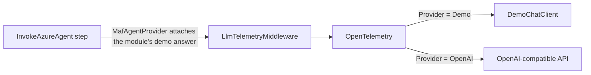

# Demo mode and LLM providers

[← README](../README.md) · [Workflow reference](workflow-reference.md) · [Dashboard](dashboard.md)

The engine owns LLM access; module services never call a model for workflow steps. Two providers exist:

| `Flowgent:Llm:Provider` | Behaviour |
|-------------------------|-----------|
| `Demo` (default) | No model, no API key, no network. Each agent step (`InvokeAzureAgent`) answers with the response its module declares in the workflow's demo file (see below). |
| `OpenAI` | Any OpenAI-compatible chat API (`ApiKey` required, optional `Endpoint`). |

Everything else (inbox, runs, tools, human input, persistence, telemetry, dashboard) behaves the same in both modes.

## Settings (`Flowgent:Llm`, engine service)

| Setting | Default | Description |
|---------|---------|-------------|
| `Provider` | `Demo` | `Demo` or `OpenAI` (case-insensitive). |
| `ModelName` | `gpt-4o-mini` | Model id used with `OpenAI`. |
| `ApiKey` | — | Required with `OpenAI`, ignored in Demo mode. |
| `Endpoint` | OpenAI | Optional absolute `http(s)` URL of an OpenAI-compatible server (e.g. Groq `https://api.groq.com/openai/v1`, Ollama `http://localhost:11434/v1`). |
| `DemoLatencyMs` | `1500` | Simulated latency per call in Demo mode, so progress is visible in the dashboard. `0` = instant. |

The configuration is read at startup. Keep the API key out of committed files: use the git-ignored `backend/engine/Flowgent.Engine.Service/appsettings.Development.json`, or environment variables (`Flowgent__Llm__Provider`, `Flowgent__Llm__ApiKey`, …). Example `appsettings.Development.json`:

```json
{
  "Flowgent": {
    "Llm": { "Provider": "OpenAI", "ModelName": "gpt-4o-mini", "ApiKey": "<your key>" }
  }
}
```

The AppHost can also override the provider without touching files: `dotnet run --project backend/host -- --AppHost:LlmProvider=Demo`.

## Declaring demo responses

Each module declares the demo answers of its own workflows. The engine knows no workflow: it reads the answers from the module definition. A demo file is optional; without it the workflow works normally with a real provider, and in Demo mode its agent steps fail with a message saying where to add one.

Reference the file from the workflow descriptor in `module.yaml`:

```yaml
workflows:
  - id: notes-summary
    file: workflows/notes-summary.yaml
    demo: demo/notes-summary.yaml     # optional
    # ...
```

The file lists the answer of each agent step, by step id (the left part of the agent name `"<stepId>|<agentId>"`, or the whole name when it has no `|`):

```yaml
# yaml-language-server: $schema=../../../../shared/Flowgent.Definitions/Schemas/demo.schema.json
steps:
  summarize:
    extract:
      text: { field: Text }                                  # text after "Text:" in the prompt
      topic: { pattern: 'about:\s*(.+)', default: "{prompt}" } # first capture group, else the default
    rules:                                                    # optional, first match wins
      - when: '\burgent\b'                                    # regex on the prompt, case-insensitive
        output: { summary: "[Demo] URGENT: {text}" }
    output:                                                   # used when no rule matches
      summary: "[Demo] {text}"
```

| Key | Meaning |
|-----|---------|
| `extract.<name>.field` | The text after a `Label:` line of the rendered prompt, up to the next blank line or `Label:` line. |
| `extract.<name>.pattern` | A regex on the prompt (`.` also matches new lines, case-sensitive); the value is the first capture group, or the whole match. |
| `extract.<name>.default` | Used when the value is empty; may contain `{prompt}`. |
| `rules[]` | `when` regex (case-insensitive) and `output`; the first rule that matches wins. |
| `output` | The answer when no rule matches. A step needs `output`, `rules`, or both. |

Every string of an output accepts `{name}` placeholders from `extract`, plus `{prompt}` (the whole trimmed prompt). Numbers, booleans, `null`, arrays and nested objects are returned as written. The answer is what the agent step would return, so it must match what the next actions read (for example the fields a `flowgent.parse` result is read with).

Keep each step's prompt in a stable shape (for example `Subject: …\n\nBody: …`) so the demo file can read it.

The template module has a commented example: [`backend/modules/_template/definition/demo/template-hello.yaml`](../backend/modules/_template/definition/demo/template-hello.yaml). `GET /api/engine/schemas/demo` serves the JSON Schema of the file.

The engine checks the file when it loads the module: format, regexes, and unknown placeholders are errors (the module is not loaded); a step id that no agent step of the workflow uses is a warning.

## How it works



In Demo mode the agent provider asks `DemoResponseProvider` for the step's answer, computed from the workflow's demo file and the rendered prompt, and attaches the JSON to the call (`LlmCallAttribution.WithDemoResponse`); `DemoChatClient` waits `DemoLatencyMs` and returns it with model `demo-simulated` and an estimated token usage (about 4 characters per token). The call still uses the non-streaming path so it goes through the same telemetry middleware as a real one, so the Agents page shows calls, tokens and latency.

When Demo mode is active and the workflow has no demo file, or the file has no entry for the step, the step fails with `No demo response is defined for step '<id>' of workflow '<id>'.` followed by where to add it. If no rule matches and the step has no `output`, it fails as well.

## In the dashboard

`GET /api/engine/config` returns `{ sequentialProcessing, demoMode, llmProvider, llmModel }`. The Overview header shows a **Demo Mode** badge, or the provider and model (e.g. **OpenAI · gpt-4o-mini**). The API key and endpoint are never exposed.

## Limitations

- Demo answers are fixed outputs with placeholders, chosen by regex rules on the rendered prompt; they cannot compute values or read earlier step outputs.
- Use the `OpenAI` provider to evaluate prompts and model behaviour.
