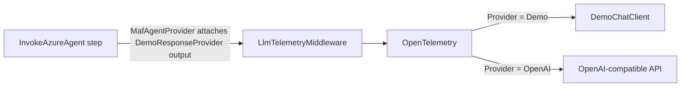

# Demo mode and LLM providers

[← README](../README.md) · [Workflow reference](workflow-reference.md) · [Dashboard](dashboard.md)

The engine owns LLM access; module services never call a model for workflow steps. Two providers exist:

| `Flowgent:Llm:Provider` | Behaviour |
|-------------------------|-----------|
| `Demo` (default) | No model, no API key, no network. Each agent step (`InvokeAzureAgent`) answers with the response the engine's `DemoResponseProvider` computes for `(workflowId, stepId)`. |
| `OpenAI` | Any OpenAI-compatible chat API (`ApiKey` required, optional `Endpoint`). |

Everything else (inbox, runs, tools, human input, persistence, telemetry, dashboard) behaves the same in both modes.

## Settings (`Flowgent:Llm`, engine service)

| Setting | Default | Description |
|---------|---------|-------------|
| `Provider` | `Demo` | `Demo` or `OpenAI` (case-insensitive). |
| `ModelName` | `gpt-4o-mini` | Model id used with `OpenAI`. |
| `ApiKey` | — | Required with `OpenAI`, ignored in Demo mode. |
| `Endpoint` | OpenAI | Optional absolute `http(s)` URL of an OpenAI-compatible server (e.g. Groq `https://api.groq.com/openai/v1`, Ollama `http://localhost:11434/v1`). |
| `DemoLatencyMs` | `1500` | Simulated latency per call in Demo mode, so progress is visible in the dashboard. `0` = instant. |

The configuration is read at startup. Keep the API key out of committed files: use the git-ignored `backend/src/Services/Flowgent.Engine.Service/appsettings.Development.json`, or environment variables (`Flowgent__Llm__Provider`, `Flowgent__Llm__ApiKey`, …). Example `appsettings.Development.json`:

```json
{
  "Flowgent": {
    "Llm": { "Provider": "OpenAI", "ModelName": "gpt-4o-mini", "ApiKey": "<your key>" }
  }
}
```

The AppHost can also override the provider without touching files: `dotnet run --project backend/src/AppHost/Flowgent.AppHost -- --AppHost:LlmProvider=Demo`.

## Declaring demo responses

Demo responses live in the engine's `DemoResponseProvider` (C#), not in the workflow YAML — migrated workflows carry **no** `demo:` block. The provider is keyed by `(workflowId, stepId)` and returns the JSON an agent step would have produced, computed from the rendered prompt (so a step's prompt keeps a stable, parseable shape, e.g. jokes `Tell a joke about: <topic>`, support `Subject: …\n\nBody: …`). When you add an agent step, add the matching key:

```csharp
// Flowgent.Runtime/Llm/DemoResponseProvider.cs
public JsonNode Resolve(string workflowId, string stepId, string renderedPrompt, RunContext run) =>
    (workflowId, stepId) switch
    {
        ("notes-summary", "summarize") => new JsonObject { ["summary"] = $"[Demo] {Truncate(Field(renderedPrompt, "Text"), 80)}" },
        // …
        _ => throw new StepFailedException(stepId, $"No demo response is defined for step '{stepId}' of workflow '{workflowId}'."),
    };
```

Keyword routing reuses the retained `RuleMatcher` over `MatchRule` records, so Demo classification stays the ordered first-match-wins behaviour it had in YAML.

## How it works



In Demo mode the agent provider calls `DemoResponseProvider.Resolve` and attaches the JSON to the call (`LlmCallAttribution.WithDemoResponse`); `DemoChatClient` waits `DemoLatencyMs` and returns it with model `demo-simulated` and an estimated token usage (about 4 characters per token). The call still uses the non-streaming path so it goes through the same telemetry middleware as a real one, so the Agents page shows calls, tokens and latency.

When Demo mode is active and an agent step has no `DemoResponseProvider` key, the step fails with `No demo response is defined for step '<id>' of workflow '<id>'.`

## In the dashboard

`GET /api/engine/config` returns `{ sequentialProcessing, demoMode, llmProvider, llmModel }`. The Overview header shows a **Demo Mode** badge, or the provider and model (e.g. **OpenAI · gpt-4o-mini**). The API key and endpoint are never exposed.

## Limitations

- Demo responses are as good as the logic written in `DemoResponseProvider`; they read only the rendered prompt.
- Use the `OpenAI` provider to evaluate prompts and model behaviour.
